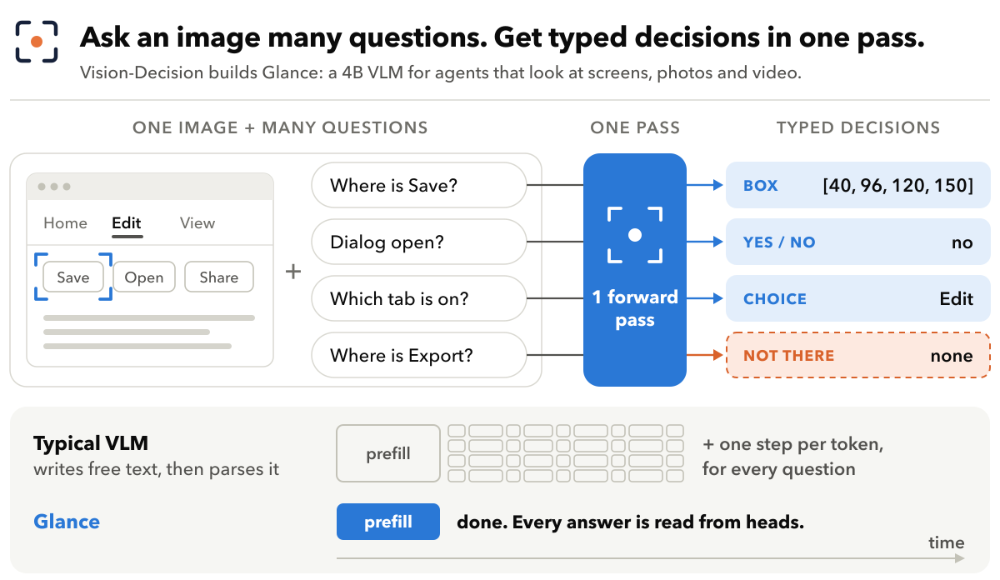

  

<picture>
  <source media="(prefers-color-scheme: dark)" srcset="assets/hero-dark.svg">
  
</picture>

  视觉决策模型：一次前向，回答一张图上的许多问题。

### Why

Agents mostly need decisions, not prose: *Where is the button? Is it there at all? Which clip shows it?* Generative VLMs write every answer token by token, which is slow and turns "not there" into a guess; Glance reads them all from one pass.

### Highlights

- **A new data pipeline and harder grounding data.** Glance-COCO adds hard negatives involving attributes, counts, and spatial relations, along with requests that refer to multiple objects. The pipeline uses human-annotated COCO boxes and sets aside separate images for evaluation. [Glance-COCO](https://github.com/Vision-Decision/Glance-COCO)
- **4B and 0.8B models.** Glance makes typed visual decisions. Glance-X explores a bidirectional grounding architecture that reuses image computation across requests or request computation across images. [Glance](https://github.com/Vision-Decision/Glance)
- **GPU and Mac inference engines.** The [GPU engine](https://github.com/Vision-Decision/Glance-Engine) targets 4B models across Glance and Glance-X. The Mac engine targets the 0.8B Glance-X-Lite model on Apple silicon. [Glance-X-Lite](https://github.com/Vision-Decision/Glance-X-Lite)

### Projects

**Models**

- [**Glance**](https://github.com/Vision-Decision/Glance): a 4B decision VLM built on Qwen3.5-4B. One pass answers many typed questions about an image.
- [**Glance-X-Lite**](https://github.com/Vision-Decision/Glance-X-Lite) is a 0.8B grounding model that finds objects from text. It supports many requests per image and one request across many images. [Model weights](https://huggingface.co/Vision-Decision/Glance-X-Lite).

**Data**

- [**Glance-COCO**](https://github.com/Vision-Decision/Glance-COCO): grounding data with exact boxes, many phrasings, Chinese requests, hard negatives and multi-target queries, also on [Hugging Face](https://huggingface.co/datasets/Vision-Decision/Glance-COCO).

**Systems**

- [**Glance-Engine**](https://github.com/Vision-Decision/Glance-Engine): serving engine for decision models. Many questions per image, or one question over many cached images or clips.
- [**Glance-Core**](https://github.com/Vision-Decision/Glance-Core): model package, training, data builders and evaluation for Glance.
- [**Glance-Video**](https://github.com/Vision-Decision/Glance-Video): Glance for video, a clip-scanning search tool that agents can call.
